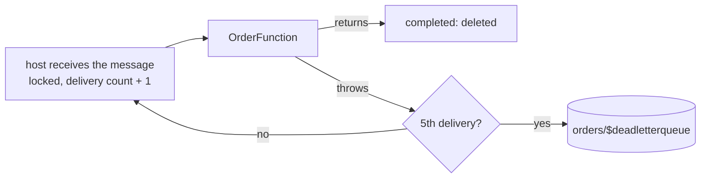

# Service Bus consumer – Azure Functions PoC

A Service Bus-triggered Azure Function in Java 21, on the Flex Consumption plan (scales to zero, billed per execution), with production patterns: retries, dead-letter queue, alerts, duplicate detection, at-least-once handling, Entra ID only for messaging (no Service Bus keys). All infrastructure is Terraform.

```
bootstrap/                Terraform, run once: storage for the Terraform states, its own included (see "Terraform" below)
infra/                    Terraform: the PoC (Service Bus queue, Function App, its identity and roles, Application Insights, alerts)
app/                      Maven: the function, packaged by azure-functions-maven-plugin. One dependency, plus JUnit for the tests.
  OrderFunction.java      Service Bus trigger: complete or retry, one log line per outcome      <- start here
  OrderHandler.java       business logic stub with simulated failures
  host.json               concurrency, lock renewal, logging
  OrderFunctionTest.java  unit tests: completed or redelivered, as Service Bus would do
```

## Run it

Prerequisites: Owner on an Azure subscription (Terraform creates role assignments), and:

```bash
brew install azure-cli hashicorp/tap/terraform openjdk@21 maven   # not plain `terraform`: Homebrew's own is frozen at 1.5.7 (licence change)
sudo ln -sfn "$(brew --prefix)/opt/openjdk@21/libexec/openjdk.jdk" /Library/Java/JavaVirtualMachines/openjdk-21.jdk   # openjdk@21 is keg-only
```

```bash
az login
export ARM_SUBSCRIPTION_ID=$(az account show --query id -o tsv)   # the subscription Terraform deploys into
az functionapp list-flexconsumption-locations --query "[].name" -o tsv | grep -i switzerland
# Nothing printed: Flex Consumption isn't available in Switzerland North, add -var location=<a listed region> to step 2's plan

# Once per subscription: register the Azure services used here. Terraform requests them too, but Azure finishes in the
# background, so a first apply can fail with MissingSubscriptionRegistration.
for ns in Microsoft.ServiceBus Microsoft.Storage Microsoft.ManagedIdentity Microsoft.Web Microsoft.OperationalInsights Microsoft.Insights; do
  az provider register --namespace "$ns" --wait
done

# 1. Once per subscription: the storage for the Terraform states (bootstrap/).
#    Its own state ends up in it too, but the first apply needs a local state: the storage doesn't exist yet.
cd bootstrap
printf 'terraform {\n  backend "local" {}\n}\n' > backend_override.tf   # temporary: replaces the backend of versions.tf
terraform init -reconfigure                                             # -reconfigure: ignore a backend left by a previous run
terraform apply
terraform output -raw backend_config > backend.hcl
rm backend_override.tf                                                  # back to the backend of versions.tf...
terraform init -migrate-state -backend-config=backend.hcl               # ...answer "yes": copies the local state into the storage
terraform state list                                                    # checks the state is now read from Azure
rm -f terraform.tfstate terraform.tfstate.backup                        # no longer used, and they may hold the account keys

# 2. The PoC infrastructure (its state goes to the same storage)
cd ../infra
cp ../bootstrap/backend.hcl .
echo 'alert_email = "you@example.com"' > terraform.tfvars   # your address, for the alerts (git-ignored; plan and destroy read it)
terraform init -reconfigure -backend-config=backend.hcl
terraform plan -out=tfplan                      # review what will change...
terraform apply tfplan                          # ...and apply exactly that
eval "$(terraform output -raw env)"             # variables used by the commands below

# 3. Build the function and deploy it
cd ../app
mvn -q clean package                            # runs the unit tests, then builds target/azure-functions/queue-poc/
(cd target/azure-functions/queue-poc && zip -qr ../../queue-poc.zip .)
az functionapp deployment source config-zip -g "$RESOURCE_GROUP" -n "$FUNCTION_APP" --src target/queue-poc.zip

# 4. Test messages. The Azure CLI can't send to Service Bus, so curl calls its REST API with your Entra ID token.
#    Each order is also the message ID: the same order sent again within 10 minutes is dropped (duplicate detection).
TOKEN=$(az account get-access-token --resource https://servicebus.azure.net --query accessToken -o tsv)
for m in ok-1 ok-2 flaky-3 down-4 invalid-5; do
  curl -sS -o /dev/null -w "$m: %{http_code}\n" -X POST "https://$SERVICEBUS_NAMESPACE.servicebus.windows.net/$QUEUE_NAME/messages" \
    -H "Authorization: Bearer $TOKEN" -H "Content-Type: text/plain" -H "BrokerProperties: {\"MessageId\": \"$m\"}" --data "$m"
done                                            # 201 = accepted

# 5. Watch. Logs reach Application Insights within a minute or two (az installs its extension on first use).
az monitor app-insights query -g "$RESOURCE_GROUP" --app "$APP_INSIGHTS" --query "tables[0].rows" -o tsv \
  --analytics-query "traces | where timestamp > ago(30m) and tostring(customDimensions.Category) == 'Function.ProcessOrder.User' | order by timestamp asc | project timestamp, message"
az servicebus queue show -g "$RESOURCE_GROUP" --namespace-name "$SERVICEBUS_NAMESPACE" -n "$QUEUE_NAME" \
  --query "countDetails.{active: activeMessageCount, deadLettered: deadLetterMessageCount}" -o table
# Within about 10 minutes: alert emails for the dead-letter queue and for the failed runs (see "Monitoring")

# Clean up: infra first, then the state storage (protected from `terraform destroy`: see "Terraform" below)
cd ../infra && terraform destroy
az group delete --name rg-tfstate --yes
```

- To read the dead-lettered messages, find why they failed, then re-send or remove them: see "Monitoring".
- Right after an `apply`, RBAC changes take a few minutes to propagate: a `401`/`403` from curl, authorization errors in the function's logs, or a `403` from `terraform init` (step 1's state migration, step 2's first init). Wait and retry.
- After the first `terraform init` of each stack, commit the generated `.terraform.lock.hcl` (exact provider versions and checksums).
- Running the function on your machine needs Azure Functions Core Tools and a `local.settings.json` (git-ignored). This README deploys to Azure instead.

## What you should see

| Message | Outcome |
|---|---|
| `ok-*` | processed, completed (deleted) |
| `flaky-*` | fails half the time, redelivered at once; almost always succeeds within 5 attempts |
| `down-*` | fails every time: dead-letter queue after 5 attempts, within seconds, reason `MaxDeliveryCountExceeded` |
| `invalid-*` | can never succeed: same path as `down-*` (a Java function can't dead-letter a message itself) |
| the same order again within 10 minutes | dropped by duplicate detection, never delivered |

The first message after an idle period wakes the app from zero instances: expect a cold start of several seconds.

## Finding the logs

Everything lands in the Application Insights resource `appi-<name>`: **Logs** for searching (data arrives 1 to 5 minutes late), **Live Metrics** for watching in real time. To keep that searchable:

- `host.json` sends only warnings by default, plus your function's lines (`Function`), one record per run (`Host.Results`, the `requests` table) and the per-function counters (`Host.Aggregator`). Microsoft's recommended starting point.
- Every line written by `OrderFunction` carries the order, the Service Bus message ID and the delivery attempt: `Processed order ok-1 (message ok-1, attempt 1)`, `Failed order down-4 (message down-4, attempt 3): …`.
- Ask each question of the right table, and save the queries (**Logs** → **Save** → **Save as query**) so you never retype them:

```kusto
// The story of one order (replace ok-1)
traces
| where timestamp > ago(1d) and message has "ok-1"
| order by timestamp asc
| project timestamp, severityLevel, message

// Your function's lines only, latest first
traces
| where timestamp > ago(1h) and tostring(customDimensions.Category) == "Function.ProcessOrder.User"
| order by timestamp desc
| project timestamp, severityLevel, message

// Did it run, did it fail? One row per run, never dropped by sampling
requests
| where timestamp > ago(1h)
| summarize runs = count(), failures = countif(success == false) by bin(timestamp, 5m)

// Why did it fail?
exceptions
| where timestamp > ago(1h)
| summarize count() by innermostMessage

// Everything about one run (operation_Id from any row above)
union traces, exceptions, requests
| where operation_Id == "<operation_Id>"
| order by timestamp asc
```

Run one query at a time: select its lines, then **Run**.

## Monitoring

Three alerts email `alert_email` (step 2) through the action group `ag-<name>`: one email when an alert fires, one when it resolves, nothing in between. Fired alerts are listed in the portal under **Monitor** → **Alerts**. No email? Check your spam folder.

| Alert | Fires when | Then |
|---|---|---|
| `<name>-dead-letters` | a message is in the dead-letter queue (checked every minute) | triage it, below |
| `<name>-backlog` | the queue has held more than `backlog_alert_threshold` messages (default 1,000) for 15 minutes: the function is falling behind, or stopped | is the app at its 50-instance cap, or a dependency slow? Is it running at all? The host logs its errors in `traces` |
| `<name>-failures` | more than 5 runs failed within 15 minutes, each attempt counted | "Why did it fail?" in "Finding the logs" |

Size `backlog_alert_threshold` (in `terraform.tfvars`) from the longest an order may wait. A message waits about backlog ÷ processing rate (Little's law), so the threshold is the rate the function reaches at full scale, measured with a load test, × that wait: for example 50 orders/s × 600 s = 30,000. Keep it above 800: messages being processed stay in the queue until completed and count too, up to 50 instances × 16 concurrent calls. For the same reason a busy queue is never empty, so 0 ("never emptied for 15 minutes") only suits a queue with long idle periods. The gap: with little traffic, a stopped function goes unnoticed until the threshold is reached (see "Before production").

The dead-letter queue should stay empty. When a message lands there:

1. **Look.** In the portal: the Service Bus namespace, **Queues**, `orders`, **Service Bus Explorer**, **Peek Mode**, **DeadLetter**, **Peek from start**. Each message shows its body, its message ID and, under **Message Properties**, its `DeadLetterReason`.
2. **Understand.** Search the message ID in Application Insights ("The story of one order" in "Finding the logs"): one line per attempt, with its error.
3. **Fix the cause, then re-process** the messages that should be: select them, **Re-send selected messages**, **Send**. This sends copies to the queue: the originals stay in the dead-letter queue.
4. **Empty it.** **Receive Mode**, **DeadLetter**, **Receive messages**, mode **ReceiveAndDelete**. The alert resolves a few minutes later and fires again for the next message. Until then, new dead-lettered messages send no email: empty the queue after every triage.

The test messages `down-4` and `invalid-5` only need step 4.

These alerts cost nothing here: each one watches one metric time series, and Azure Monitor includes 10 per month, plus 1,000 emails. The portal may also list a *Failure Anomalies* alert rule: Azure adds it to Application Insights by itself (smart detection), outside Terraform.

## How it works



- **At-least-once.** A message can be delivered twice (a crash after processing, a lock that expired). The handler must be idempotent: deduplicate on a business key.
- **Peek-lock.** The Functions host receives a message locked for 1 minute (`lock_duration`) and renews the lock while the function runs, up to 5 minutes (`host.json`). It completes the message when the function returns and abandons it when the function throws. Up to 16 messages run in parallel per instance.
- **Retries are immediate.** Service Bus makes an abandoned message available again at once, and Azure Functions retry policies don't apply to Service Bus triggers. So a failing message uses its 5 attempts within seconds.
- **Dead-letter queue, built in.** After 5 deliveries (`max_delivery_count`), Service Bus moves the message to the queue's dead-letter queue with `DeadLetterReason` = `MaxDeliveryCountExceeded`. An expired message goes there too. Dead-lettered messages don't expire: they stay until someone removes them (see "Monitoring").
- **Crash loops.** An attempt that kills the process never reaches a `catch`, but the delivery count still grows, so the message still ends up dead-lettered.
- **Messages that can never succeed.** A C# function could dead-letter such a message at once, with its own reason. Java functions can't settle messages themselves, so `invalid-*` takes the same 5 quick attempts; the real error is in the logs.
- **Duplicate detection.** Within 10 minutes, a second message with the same message ID is dropped. Producers should use a business ID as the message ID, as the test messages do.
- **Scaling.** Zero instances while the queue is empty; more as it grows, up to `maximum_instance_count` (50). The scale controller reads the queue length with the Function App's identity.
- **Messaging: Entra ID only.** Local authentication is disabled on the namespace: no SAS keys or connection strings exist. The Function App uses its user-assigned identity, with *Azure Service Bus Data Owner* on the PoC's namespace: receiving alone would need *Data Receiver*, but the scale controller needs manage rights to read the queue length.
- **Runtime storage: one key.** The Functions runtime keeps its state and deployment packages in a storage account accessed with its key: the azurerm Flex Consumption resource doesn't support keyless runtime storage yet. That key ends up in the Function App settings and in the Terraform state. None of your messages are in that account.
- **Tracing.** Service Bus carries the trace context: when one function sends to a queue that triggers another, Application Insights shows both as one operation.

## Terraform

Azure hierarchy: tenant (Entra ID) > subscription (billing and access boundary) > resource groups > resources. Terraform does not create the subscription: you already have one (in a company, a platform team usually provides it) and `ARM_SUBSCRIPTION_ID` tells Terraform which one to use.

| Stack | Run | Its state | Creates |
|---|---|---|---|
| `bootstrap/` | once per subscription | `bootstrap.tfstate`, in the storage it creates (a local file during the first apply only) | `rg-tfstate`: storage account + `tfstate` container holding every state |
| `infra/` | at every change | `queuepoc.tfstate`, in the same storage | `rg-queuepoc`: Service Bus namespace and queue, Function App (Flex Consumption plan, runtime storage account), identity, RBAC, Application Insights, alerts |

Why two stacks: the states must survive a `terraform destroy` of the PoC, so their storage needs its own lifecycle. The PoC's own resource group stays in `infra/` because it has the same lifecycle as the PoC. If a platform team hands you the resource group, replace the `azurerm_resource_group` resource with a `data "azurerm_resource_group"` lookup (referenced as `data.azurerm_resource_group.this`).

Bootstrap keeps its own state in the storage it creates, so nothing stays on your machine (a local state file would also hold the storage account keys in plain text). That is a chicken-and-egg problem, at both ends:

- **First apply**: the storage doesn't exist yet. `backend_override.tf`, an [override file](https://developer.hashicorp.com/terraform/language/files/override) (it takes precedence over the backend of `versions.tf`, and git ignores it), switches to a local state for that one apply; `terraform init -migrate-state` then moves the state into the storage.
- **Removal**: the storage account and its container have `prevent_destroy`. They hold every state, their own included, so Terraform refuses any plan that would delete or replace them. To remove them for good, delete their resource group, after `infra/` (see "Clean up" above). Staying in Terraform is possible but longer: recreate `backend_override.tf`, `terraform init -migrate-state` (state back to a local file), set `prevent_destroy = false`, then `terraform destroy`.

Practices applied:

- **Remote state** for both stacks: private Azure Blob container (state can hold sensitive values), Entra ID auth with no keys, locking (blob lease: two applies can't collide), versioning and 30-day soft delete to restore a broken state, `prevent_destroy` on the storage.
- **Reproducible**: Terraform constrained to `~> 1.9` (any 1.x from 1.9, not 2.0) and providers to `~> 5.0`; the exact provider versions and checksums are pinned by `.terraform.lock.hcl`, committed after the first `init`; `plan -out` then `apply` of exactly that plan.
- **No secrets in the code**: none in code, variables, outputs or the backend config; the subscription comes from the environment. One key exists at runtime, the Functions runtime storage key (see "How it works").
- **Secure defaults**: Entra ID only for Service Bus (local auth disabled) and for the state storage; TLS 1.2 and no public blobs on every storage account.
- **Access through RBAC only**: the Function App's identity on the PoC's namespace (see "How it works"); operators (who send and inspect messages from their machine) listed explicitly in `operator_object_ids` once a pipeline applies.
- **Readable**: typed, validated and documented variables and outputs, tags on every taggable resource, CAF naming (`rg-`, `sb-`, `st`, `id-`, `func-`, `asp-`, `appi-`, `log-`, `ag-`), flat code (no module until something is reused).

## Settings

| Setting | Where | Value | |
|---|---|---|---|
| `max_delivery_count` | `infra/main.tf` | `5` | deliveries before the dead-letter queue |
| `lock_duration` | `infra/main.tf` | `PT1M` | lock per delivery, renewed by the host while the function runs |
| `duplicate_detection_history_time_window` | `infra/main.tf` | `PT10M` | how long a message ID is remembered |
| `maxConcurrentCalls` | `app/host.json` | `16` | messages processed in parallel per instance |
| `maxAutoLockRenewalDuration` | `app/host.json` | `00:05:00` | how long the host keeps renewing a message's lock |
| `logging.logLevel` | `app/host.json` | `Warning`, `Information` for your function | only your function's lines and the runtime's warnings reach `traces` |
| `logging.applicationInsights.samplingSettings.isEnabled` | `app/host.json` | `false` | every log line reaches Application Insights (sampling would drop some) |
| `maximum_instance_count` | `infra/main.tf` | `50` | scale-out cap, and so cost cap |
| `instance_memory_in_mb` | `infra/main.tf` | `2048` | memory per instance |
| `alert_email` | `infra/terraform.tfvars` | your address | who receives the alerts |
| `backlog_alert_threshold` | `infra/terraform.tfvars` | `1000` | messages held 15 minutes before the backlog alert fires: size it from a load test (see "Monitoring") |
| other alert thresholds | `infra/main.tf` | see "Monitoring" | when the dead-letter and failure alerts fire |
| `QUEUE_NAME`, `ServiceBus__*` | app settings, set by Terraform | | queue name and the identity-based Service Bus connection |

## Before production

- A delay between retries, if a dependency needs time to recover: on a transient failure, send a copy with a scheduled enqueue time (Service Bus SDK) and complete the original. Or let the messages dead-letter and re-send them from the dead-letter queue once the outage is over.
- Sessions (`requires_session` on the queue, `isSessionsEnabled` on the trigger) if the orders of one customer must be processed in order.
- Premium tier for private endpoints and virtual network integration (Standard has neither), dedicated capacity, and messages over 256 KB (up to 100 MB). Above that, the claim-check pattern: payload in Blob Storage, reference in the message.
- Always-ready instances (`always_ready` in `infra/main.tf`) if the cold start on the first message after an idle period matters. They're billed even when idle.
- Keyless runtime storage once the azurerm provider supports it (issue 30732), or with the `azapi` provider. Until then, rotate the runtime storage key.
- Disable basic-auth publishing (`webdeploy_publish_basic_authentication_enabled = false`) once every deployment tool you use authenticates with Entra ID.
- Run Terraform and the deployment from a pipeline (GitHub Actions, Azure DevOps) authenticated with workload identity federation (OIDC, no client secret): plan on pull request, apply on merge. Give that identity Contributor, *Storage Blob Data Contributor* on the state storage account and *Role Based Access Control Administrator* restricted to the Service Bus data roles, instead of using your Owner account. Set `operator_object_ids` (your object ID or a group): otherwise the pipeline grants itself the operators' access and removes yours.
- One state key and one `backend.hcl` per environment (`dev`, `prod`), ideally one subscription per environment.
- Protect stateful resources: the state storage already has `prevent_destroy`; production namespaces and queues need it too. A `CanNotDelete` lock also blocks deletion from the portal or the CLI.
- `terraform fmt -check`, `terraform validate`, `tflint` and `checkov` (or `trivy config`) in CI.
- Alerts where the team works: a shared mailbox, or Teams or an on-call tool through a webhook in the action group. Give the dead-letter queue an owner who triages it within an agreed time.
- A heartbeat, to catch a stopped function when traffic is low: a timer function sends a test message every 5 minutes, and an alert fires when none was processed for 15 minutes. Below `backlog_alert_threshold`, nothing else notices a function that doesn't start: scaled to zero, it logs nothing.
- Turn Application Insights sampling back on in `host.json` to control its cost: it never drops exceptions or invocations, only log lines.
- Long processing: the host renews the lock for up to `maxAutoLockRenewalDuration`; mind `functionTimeout` in `host.json` too.
