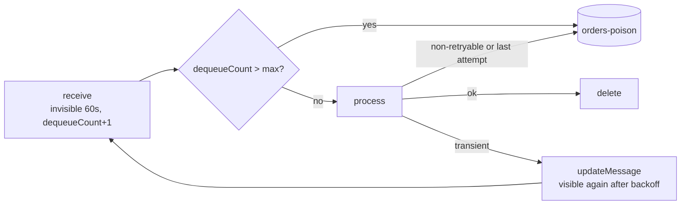

# Azure Storage Queue consumer – Java PoC

Plain Java 21, no framework, consuming an Azure Storage queue with production patterns: two retry layers with backoff, poison (dead-letter) queue, crash-loop protection, at-least-once handling, Entra ID auth, graceful shutdown. All infrastructure is Terraform.

```
bootstrap/                Terraform, run once: storage for the Terraform states, its own included (see "Terraform" below)
infra/                    Terraform: the PoC (storage account, queue + poison queue, managed identity, RBAC)
app/                      Maven: azure-storage-queue, azure-identity, slf4j. Nothing else.
  QueueConsumer.java      receive loop: retry, backoff, poison, shutdown      <- start here
  OrderHandler.java       business logic stub with simulated failures
  App.java                entry point + client settings (auth, encoding, HTTP retries)
  Config.java             environment variables, validated at startup
```

## Run it

Prerequisites: Owner on an Azure subscription (Terraform creates a custom role and role assignments), and:

```bash
brew install azure-cli hashicorp/tap/terraform openjdk@21 maven   # not plain `terraform`: Homebrew's own is frozen at 1.5.7 (licence change)
sudo ln -sfn "$(brew --prefix)/opt/openjdk@21/libexec/openjdk.jdk" /Library/Java/JavaVirtualMachines/openjdk-21.jdk   # openjdk@21 is keg-only
```

```bash
az login
export ARM_SUBSCRIPTION_ID=$(az account show --query id -o tsv)   # the subscription Terraform deploys into

# 1. Once per subscription: the storage for the Terraform states (bootstrap/).
#    Its own state ends up in it too, but the first apply needs a local state: the storage doesn't exist yet.
cd bootstrap
printf 'terraform {\n  backend "local" {}\n}\n' > backend_override.tf   # temporary: replaces the backend of versions.tf
terraform init -reconfigure                                             # -reconfigure: ignore a backend left by a previous run
terraform apply
terraform output -raw backend_config > backend.hcl
rm backend_override.tf                                                  # back to the backend of versions.tf...
terraform init -migrate-state -backend-config=backend.hcl               # ...answer "yes": copies the local state into the storage
terraform state list                                                    # checks the state is now read from Azure
rm -f terraform.tfstate terraform.tfstate.backup                        # no longer used, and they may hold the account keys

# 2. The PoC infrastructure (its state goes to the same storage)
cd ../infra
cp ../bootstrap/backend.hcl .
terraform init -reconfigure -backend-config=backend.hcl
terraform plan -out=tfplan                      # review what will change...
terraform apply tfplan                          # ...and apply exactly that
eval "$(terraform output -raw env)"             # the app's settings + defaults for az storage commands

# 3. The app. First a few test messages, sent with the Azure CLI (account and auth come from the eval above).
#    The app expects Base64, the Azure Functions default. The CLI sends text as is, so the orders are encoded here.
for m in ok-1 ok-2 flaky-3 down-4 invalid-5; do
  az storage message put -q "$QUEUE_NAME" --content "$(printf %s "$m" | base64)" -o none
done
az storage message put -q "$QUEUE_NAME" --content "plain text, not base64" -o none   # a producer that forgot to encode
cd ../app
mvn -q package
java -jar target/queue-poc.jar                  # Ctrl+C = graceful stop
az storage message peek -q "$POISON_QUEUE_NAME" --num-messages 32 -o table   # contents in Base64: echo <content> | base64 -d

# Clean up: infra first, then the state storage (protected from `terraform destroy`: see "Terraform" below)
cd ../infra && terraform destroy
az group delete --name rg-tfstate --yes
```

- Right after an `apply`, RBAC changes take a few minutes to propagate: a `403` (`AuthorizationPermissionMismatch`) from the app or from `terraform init` (step 1's state migration, step 2's first init), or `RoleDefinitionDoesNotExist` from Terraform on the first apply (the custom role is brand new). Wait and retry.
- After the first `terraform init` of each stack, commit the generated `.terraform.lock.hcl` (exact provider versions and checksums).
- From IntelliJ: open `app/pom.xml`, run `poc.App` with the env vars `QUEUE_SERVICE_URL`, `QUEUE_NAME` and `POISON_QUEUE_NAME`. If authentication fails there, the IDE does not see `az`: add `/opt/homebrew/bin` to `PATH` in the run configuration.

## What you should see

| Message | Outcome |
|---|---|
| `ok-*` | processed, deleted |
| `flaky-*` | fails half the time, retried after ~5s, 10s, 20s, 40s; almost always succeeds in the end |
| `down-*` | fails every time, poison queue after attempt 5 (about 2 min) |
| `invalid-*` | `NonRetryableException`: poison queue immediately |
| raw text | not valid Base64: the SDK decoding hook moves it to poison immediately |

Try `kill -9` on the consumer while it works: in-flight messages come back after the visibility timeout (60s) and are processed again. That is at-least-once delivery.

## How the consumer works



- **At-least-once.** A message can be delivered twice (crash after processing, processing longer than the visibility timeout). The handler must be idempotent: deduplicate on a business key.
- **Two retry layers.** Transport: the SDK retries timeouts and 5xx (`RequestRetryOptions`: 4 tries of 5 s max, so one call gives up in under 30 s, well inside the visibility timeout: a delete or update must not outlive the message's lease). Message: a failed message is not re-sent; its visibility is pushed back with `updateMessage` (exponential backoff + jitter). No duplicate, and `dequeueCount` stays the source of truth for attempts.
- **Poison queue.** Storage queues have no dead-letter queue (Service Bus has one), so the consumer copies the message to `<queue>-poison` (Azure Functions convention) and then deletes it. In that order, a crash can duplicate, never lose. The poison copy never expires (default TTL is 7 days).
- **Crash loops.** A message that kills the process never reaches a `catch`, but its `dequeueCount` keeps growing: `dequeueCount > MAX_ATTEMPTS` sends it to poison before processing.
- **Undecodable messages.** With Base64 encoding (the Azure Functions default), one raw message would make every receive call fail. The SDK `processMessageDecodingError` hook moves it to poison.
- **Bounded concurrency, no local buffer.** Virtual threads + a semaphore: the loop receives only as many messages as there are free workers, so nothing burns its visibility timeout waiting in memory.
- **Empty queue backoff.** Polls every 1s, doubling up to 10s while the queue stays empty.
- **Graceful shutdown.** SIGTERM / Ctrl+C stops receiving and waits for in-flight messages, up to the visibility timeout (after that they are redelivered anyway).
- **No secrets.** Shared keys are disabled on the account. The app uses your `az login` locally (`AzureCliCredential`) and, in Azure, the managed identity whose client ID is in `AZURE_CLIENT_ID` (`ManagedIdentityCredential`). Explicit on purpose: `DefaultAzureCredential` tries a chain of credentials and can silently fall back to another one, so Microsoft recommends a specific credential in production.
- **Least privilege.** Terraform also creates the consumer's managed identity: a custom role on the main queue only (receive, delete, update; no built-in role is that narrow: *Message Processor* cannot `updateMessage`, *Data Contributor* can also delete the queue), `Message Sender` only on the poison queue. These roles are only exercised once the consumer runs in Azure: locally, everything runs as you.

## Terraform

Azure hierarchy: tenant (Entra ID) > subscription (billing and access boundary) > resource groups > resources. Terraform does not create the subscription: you already have one (in a company, a platform team usually provides it) and `ARM_SUBSCRIPTION_ID` tells Terraform which one to use.

| Stack | Run | Its state | Creates |
|---|---|---|---|
| `bootstrap/` | once per subscription | `bootstrap.tfstate`, in the storage it creates (a local file during the first apply only) | `rg-tfstate`: storage account + `tfstate` container holding every state |
| `infra/` | at every change | `queuepoc.tfstate`, in the same storage | `rg-queuepoc`: storage account, queues, managed identity, custom role, RBAC |

Why two stacks: the states must survive a `terraform destroy` of the PoC, so their storage needs its own lifecycle. The PoC's own resource group stays in `infra/` because it has the same lifecycle as the PoC. If a platform team hands you the resource group, replace the `azurerm_resource_group` resource with a `data "azurerm_resource_group"` lookup (referenced as `data.azurerm_resource_group.this`).

Bootstrap keeps its own state in the storage it creates, so nothing stays on your machine (a local state file would also hold the storage account keys in plain text). That is a chicken-and-egg problem, at both ends:

- **First apply**: the storage doesn't exist yet. `backend_override.tf`, an [override file](https://developer.hashicorp.com/terraform/language/files/override) (it takes precedence over the backend of `versions.tf`, and git ignores it), switches to a local state for that one apply; `terraform init -migrate-state` then moves the state into the storage.
- **Removal**: the storage account and its container have `prevent_destroy`. They hold every state, their own included, so Terraform refuses any plan that would delete or replace them. To remove them for good, delete their resource group, after `infra/` (see "Clean up" above). Staying in Terraform is possible but longer: recreate `backend_override.tf`, `terraform init -migrate-state` (state back to a local file), set `prevent_destroy = false`, then `terraform destroy`.

Practices applied:

- **Remote state** for both stacks: private Azure Blob container (state can hold sensitive values), Entra ID auth with no keys, locking (blob lease: two applies can't collide), versioning and 30-day soft delete to restore a broken state, `prevent_destroy` on the storage.
- **Reproducible**: Terraform constrained to `~> 1.9` (any 1.x from 1.9, not 2.0) and providers to `~> 5.0`; the exact provider versions and checksums are pinned by `.terraform.lock.hcl`, committed after the first `init`; `plan -out` then `apply` of exactly that plan.
- **No secrets**: none in code, variables, outputs or the backend config. The subscription comes from the environment.
- **Secure defaults** on every storage account: shared keys disabled, TLS 1.2, no public blobs.
- **Least privilege**: RBAC scoped per queue for the app identity, with a custom role where no built-in role fits. Operators (who send and read messages from their machine) are listed explicitly in `operator_object_ids` once a pipeline applies.
- **Readable**: typed, validated and documented variables and outputs, tags on every taggable resource, CAF naming (`rg-`, `st`, `id-`), flat code (no module until something is reused).

## Settings

| Env var | Default | |
|---|---|---|
| `QUEUE_SERVICE_URL` | required | `https://<account>.queue.core.windows.net` |
| `QUEUE_NAME` | `orders` | |
| `POISON_QUEUE_NAME` | `<QUEUE_NAME>-poison` | |
| `CONCURRENCY` | `16` | messages processed in parallel per instance |
| `VISIBILITY_TIMEOUT_SECONDS` | `60` | must exceed one message's processing time + 30 s (one HTTP call's retries) |
| `MAX_ATTEMPTS` | `5` | then poison |
| `RETRY_BASE_DELAY_SECONDS` | `5` | backoff 5, 10, 20, 40s... (+ up to 20% jitter) |
| `RETRY_MAX_DELAY_SECONDS` | `300` | backoff cap |
| `AZURE_CLIENT_ID` | unset | in Azure: client ID of the consumer's managed identity (output `consumer_identity_client_id`). Unset: your `az login` |

Invalid values (`CONCURRENCY=0`, a typo in a number...) stop the app at startup with the variable's name.

## Before production

- Run it as a container (Azure Container Apps) with the `id-<name>-consumer` identity (`AZURE_CLIENT_ID` = output `consumer_identity_client_id`) and a KEDA `azure-queue` scale rule. Set `terminationGracePeriodSeconds` (30 s by default) to at least the visibility timeout, so that a scale-in lets in-flight messages finish. That first run in Azure is also the first real test of the consumer's roles.
- Private endpoint + public network access disabled, ZRS replication.
- Run Terraform from a pipeline (GitHub Actions, Azure DevOps) authenticated with workload identity federation (OIDC, no client secret): plan on pull request, apply on merge. Give that identity Contributor, *Storage Blob Data Contributor* on the state storage account, the right to manage the consumer's custom role (`Microsoft.Authorization/roleDefinitions/*`) and *Role Based Access Control Administrator* restricted to the queue roles, instead of using your Owner account. Set `operator_object_ids` (your object ID or a group): otherwise the pipeline grants itself the operators' queue access and removes yours.
- One state key and one `backend.hcl` per environment (`dev`, `prod`), ideally one subscription per environment.
- Protect stateful resources: the state storage already has `prevent_destroy`; production queues need it too. A `CanNotDelete` lock also blocks deletion from the portal or the CLI.
- `terraform fmt -check`, `terraform validate`, `tflint` and `checkov` (or `trivy config`) in CI.
- Alert on the poison queue length. Azure Monitor's queue message count is per storage account, not per queue: publish the poison queue's `getApproximateMessagesCount()` as a custom metric or check it on a schedule.
- Long processing: renew the lease (`updateMessage` periodically) or raise `VISIBILITY_TIMEOUT_SECONDS`.
- Payload over ~48 KB (the 64 KB limit applies after Base64 encoding): claim-check pattern (payload in Blob Storage, reference in the message).
- Need ordering, sessions, a native DLQ, duplicate detection or transactions: that is Service Bus, not Storage queues.
