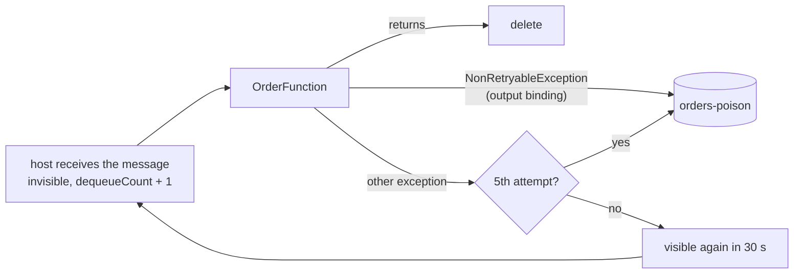

# Azure Storage Queue consumer – Azure Functions PoC

A queue-triggered Azure Function in Java 21, on the Flex Consumption plan (scales to zero, billed per execution), consuming an Azure Storage queue with production patterns: retries, poison queue, crash-loop protection, at-least-once handling, Entra ID access to the queues. All infrastructure is Terraform.

```
bootstrap/                Terraform, run once: storage for the Terraform states, its own included (see "Terraform" below)
infra/                    Terraform: the PoC (queues, Function App, its identity and roles, Application Insights)
app/                      Maven: the function, packaged by azure-functions-maven-plugin. One dependency, plus JUnit for the tests.
  OrderFunction.java      queue trigger: success, retry, poison      <- start here
  OrderHandler.java       business logic stub with simulated failures
  host.json               retries, poison queue, concurrency, polling
  OrderFunctionTest.java  unit tests: deleted, retried or poisoned, as the host would do
```

## Run it

Prerequisites: Owner on an Azure subscription (Terraform creates a custom role and role assignments), and:

```bash
brew install azure-cli hashicorp/tap/terraform openjdk@21 maven   # not plain `terraform`: Homebrew's own is frozen at 1.5.7 (licence change)
sudo ln -sfn "$(brew --prefix)/opt/openjdk@21/libexec/openjdk.jdk" /Library/Java/JavaVirtualMachines/openjdk-21.jdk   # openjdk@21 is keg-only
```

```bash
az login
export ARM_SUBSCRIPTION_ID=$(az account show --query id -o tsv)   # the subscription Terraform deploys into
az functionapp list-flexconsumption-locations --query "[].name" -o tsv | grep -i switzerland
# Nothing printed: Flex Consumption isn't available in Switzerland North, add -var location=<a listed region> to step 2's plan

# Once per subscription: register the Azure services used here. Terraform requests them too, but Azure finishes in the
# background, so a first apply can fail with MissingSubscriptionRegistration.
for ns in Microsoft.Storage Microsoft.ManagedIdentity Microsoft.Web Microsoft.OperationalInsights Microsoft.Insights; do
  az provider register --namespace "$ns" --wait
done

# 1. Once per subscription: the storage for the Terraform states (bootstrap/).
#    Its own state ends up in it too, but the first apply needs a local state: the storage doesn't exist yet.
cd bootstrap
printf 'terraform {\n  backend "local" {}\n}\n' > backend_override.tf   # temporary: replaces the backend of versions.tf
terraform init -reconfigure                                             # -reconfigure: ignore a backend left by a previous run
terraform apply
terraform output -raw backend_config > backend.hcl
rm backend_override.tf                                                  # back to the backend of versions.tf...
terraform init -migrate-state -backend-config=backend.hcl               # ...answer "yes": copies the local state into the storage
terraform state list                                                    # checks the state is now read from Azure
rm -f terraform.tfstate terraform.tfstate.backup                        # no longer used, and they may hold the account keys

# 2. The PoC infrastructure (its state goes to the same storage)
cd ../infra
cp ../bootstrap/backend.hcl .
terraform init -reconfigure -backend-config=backend.hcl
terraform plan -out=tfplan                      # review what will change...
terraform apply tfplan                          # ...and apply exactly that
eval "$(terraform output -raw env)"             # variables used by the commands below

# 3. Build the function and deploy it
cd ../app
mvn -q clean package                            # runs the unit tests, then builds target/azure-functions/queue-poc/
(cd target/azure-functions/queue-poc && zip -qr ../../queue-poc.zip .)
az functionapp deployment source config-zip -g "$RESOURCE_GROUP" -n "$FUNCTION_APP" --src target/queue-poc.zip

# 4. Test messages, sent with the Azure CLI (account and auth come from the eval above).
#    Messages are Base64, the Azure Functions default. The CLI sends text as is, so the orders are encoded here.
for m in ok-1 ok-2 flaky-3 down-4 invalid-5; do
  az storage message put -q "$QUEUE_NAME" --content "$(printf %s "$m" | base64)" -o none
done

# 5. Watch. Logs reach Application Insights within a minute or two (az installs its extension on first use).
az monitor app-insights query -g "$RESOURCE_GROUP" --app "$APP_INSIGHTS" --query "tables[0].rows" -o tsv \
  --analytics-query "traces | where timestamp > ago(30m) and tostring(customDimensions.Category) == 'Function.ProcessOrder.User' | order by timestamp asc | project timestamp, message"
az storage message peek -q "$POISON_QUEUE_NAME" --num-messages 32 -o table   # contents in Base64: echo <content> | base64 -d

# Clean up: infra first, then the state storage (protected from `terraform destroy`: see "Terraform" below)
cd ../infra && terraform destroy
az group delete --name rg-tfstate --yes
```

- Right after an `apply`, RBAC changes take a few minutes to propagate: a `403` (`AuthorizationPermissionMismatch`) from `terraform init` (step 1's state migration, step 2's first init), authorization errors in the function's logs, or `RoleDefinitionDoesNotExist` from Terraform on the first apply (the custom role is brand new). Wait and retry.
- After the first `terraform init` of each stack, commit the generated `.terraform.lock.hcl` (exact provider versions and checksums).
- Running the function on your machine needs Azure Functions Core Tools and a `local.settings.json` (git-ignored). This README deploys to Azure instead.

## What you should see

| Message | Outcome |
|---|---|
| `ok-*` | processed, deleted |
| `flaky-*` | fails half the time, retried every 30 s; almost always succeeds within 5 attempts |
| `down-*` | fails every time: poison queue after attempt 5, about 2 minutes later |
| `invalid-*` | `NonRetryableException`: poison queue immediately, through the output binding |

The first message after an idle period wakes the app from zero instances: expect a cold start of several seconds.

## Finding the logs

Everything lands in the Application Insights resource `appi-<name>`: **Logs** for searching (data arrives 1 to 5 minutes late), **Live Metrics** for watching in real time. To keep that searchable:

- `host.json` sends only warnings by default, plus your function's lines (`Function`), one record per run (`Host.Results`, the `requests` table) and the per-function counters (`Host.Aggregator`). Microsoft's recommended starting point.
- Every line written by `OrderFunction` carries the order, the queue message ID and the attempt: `Processed order ok-1 (message 6a1f…, attempt 1)`, `Failed order down-4 (message …, attempt 3): …`, `Moved order invalid-5 (message …, attempt 1) to the poison queue: …`.
- Ask each question of the right table, and save the queries (**Logs** → **Save** → **Save as query**) so you never retype them:

```kusto
// The story of one order (replace ok-1)
traces
| where timestamp > ago(1d) and message has "ok-1"
| order by timestamp asc
| project timestamp, severityLevel, message

// Your function's lines only, latest first
traces
| where timestamp > ago(1h) and tostring(customDimensions.Category) == "Function.ProcessOrder.User"
| order by timestamp desc
| project timestamp, severityLevel, message

// Did it run, did it fail? One row per run, never dropped by sampling
requests
| where timestamp > ago(1h)
| summarize runs = count(), failures = countif(success == false) by bin(timestamp, 5m)

// Why did it fail?
exceptions
| where timestamp > ago(1h)
| summarize count() by innermostMessage

// Everything about one run (operation_Id from any row above)
union traces, exceptions, requests
| where operation_Id == "<operation_Id>"
| order by timestamp asc
```

Run one query at a time: select its lines, then **Run**.

## How it works



- **At-least-once.** A message can be delivered twice (a crash after processing, an instance stopped mid-run). The handler must be idempotent: deduplicate on a business key.
- **The Functions host does the consumer's work.** It polls the queue (backing off up to 2 s while it's empty), runs up to 16 messages in parallel per instance, keeps a running message invisible, deletes it on success, makes it visible again 30 s after an exception, and moves it to `<queue>-poison` after 5 attempts. The delay is fixed: queue triggers have no exponential backoff.
- **Crash loops.** An attempt that kills the process never reaches a `catch`, but the message's `dequeueCount` still grows: the host sends it to the poison queue once it exceeds 5.
- **Non-retryable failures.** `OrderFunction` catches `NonRetryableException`, writes the message to the poison queue through an output binding, and returns normally so the host deletes the original. Any other exception is retried.
- **Base64.** The host decodes messages as Base64 (`messageEncoding` in `host.json`), the Azure Functions default: producers must encode.
- **Poison messages expire.** The host and the output binding write them with the queue's default time-to-live: 7 days. Alert on the poison queue (see "Before production").
- **Scaling.** Zero instances while the queue is empty; more as it grows, up to `maximum_instance_count` (50).
- **Queues: Entra ID, no key.** The Function App uses its user-assigned identity: a custom role on the main queue (read the queue; receive, peek, delete and update messages) and *Storage Queue Data Contributor* on the poison queue only.
- **Runtime storage: one key.** The Functions runtime keeps its state and deployment packages in a second storage account, accessed with its key: the azurerm Flex Consumption resource doesn't support keyless runtime storage yet. That key ends up in the Function App settings and in the Terraform state. None of your messages are in that account.

## Terraform

Azure hierarchy: tenant (Entra ID) > subscription (billing and access boundary) > resource groups > resources. Terraform does not create the subscription: you already have one (in a company, a platform team usually provides it) and `ARM_SUBSCRIPTION_ID` tells Terraform which one to use.

| Stack | Run | Its state | Creates |
|---|---|---|---|
| `bootstrap/` | once per subscription | `bootstrap.tfstate`, in the storage it creates (a local file during the first apply only) | `rg-tfstate`: storage account + `tfstate` container holding every state |
| `infra/` | at every change | `queuepoc.tfstate`, in the same storage | `rg-queuepoc`: queue storage account and queues, Function App (Flex Consumption plan, runtime storage account), identity, custom role, RBAC, Application Insights |

Why two stacks: the states must survive a `terraform destroy` of the PoC, so their storage needs its own lifecycle. The PoC's own resource group stays in `infra/` because it has the same lifecycle as the PoC. If a platform team hands you the resource group, replace the `azurerm_resource_group` resource with a `data "azurerm_resource_group"` lookup (referenced as `data.azurerm_resource_group.this`).

Bootstrap keeps its own state in the storage it creates, so nothing stays on your machine (a local state file would also hold the storage account keys in plain text). That is a chicken-and-egg problem, at both ends:

- **First apply**: the storage doesn't exist yet. `backend_override.tf`, an [override file](https://developer.hashicorp.com/terraform/language/files/override) (it takes precedence over the backend of `versions.tf`, and git ignores it), switches to a local state for that one apply; `terraform init -migrate-state` then moves the state into the storage.
- **Removal**: the storage account and its container have `prevent_destroy`. They hold every state, their own included, so Terraform refuses any plan that would delete or replace them. To remove them for good, delete their resource group, after `infra/` (see "Clean up" above). Staying in Terraform is possible but longer: recreate `backend_override.tf`, `terraform init -migrate-state` (state back to a local file), set `prevent_destroy = false`, then `terraform destroy`.

Practices applied:

- **Remote state** for both stacks: private Azure Blob container (state can hold sensitive values), Entra ID auth with no keys, locking (blob lease: two applies can't collide), versioning and 30-day soft delete to restore a broken state, `prevent_destroy` on the storage.
- **Reproducible**: Terraform constrained to `~> 1.9` (any 1.x from 1.9, not 2.0) and providers to `~> 5.0`; the exact provider versions and checksums are pinned by `.terraform.lock.hcl`, committed after the first `init`; `plan -out` then `apply` of exactly that plan.
- **No secrets in the code**: none in code, variables, outputs or the backend config; the subscription comes from the environment. One key exists at runtime, the Functions runtime storage key (see "How it works").
- **Secure defaults** on every storage account: TLS 1.2, no public blobs, shared keys disabled except on the runtime storage account.
- **Least privilege**: RBAC scoped per queue for the Function App's identity, with a custom role where no built-in role fits. Operators (who send and read messages from their machine) are listed explicitly in `operator_object_ids` once a pipeline applies.
- **Readable**: typed, validated and documented variables and outputs, tags on every taggable resource, CAF naming (`rg-`, `st`, `id-`, `func-`, `asp-`, `appi-`, `log-`), flat code (no module until something is reused).

## Settings

| Setting | Where | Value | |
|---|---|---|---|
| `batchSize` | `app/host.json` | `16` | messages processed in parallel per instance |
| `maxDequeueCount` | `app/host.json` | `5` | attempts before the poison queue |
| `visibilityTimeout` | `app/host.json` | `00:00:30` | delay before a failed message is retried |
| `maxPollingInterval` | `app/host.json` | `00:00:02` | longest wait between two polls of an empty queue |
| `messageEncoding` | `app/host.json` | `base64` | what producers must send |
| `logging.logLevel` | `app/host.json` | `Warning`, `Information` for your function | only your function's lines and the runtime's warnings reach `traces` |
| `logging.applicationInsights.samplingSettings.isEnabled` | `app/host.json` | `false` | every log line reaches Application Insights (sampling would drop some) |
| `maximum_instance_count` | `infra/main.tf` | `50` | scale-out cap, and so cost cap |
| `instance_memory_in_mb` | `infra/main.tf` | `2048` | memory per instance |
| `QUEUE_NAME`, `POISON_QUEUE_NAME`, `QueueStorage__*` | app settings, set by Terraform | | queue names and the identity-based queue connection |

## Before production

- Always-ready instances (`always_ready` in `infra/main.tf`) if the cold start on the first message after an idle period matters. They're billed even when idle.
- Keyless runtime storage once the azurerm provider supports it (issue 30732), or with the `azapi` provider. Until then, rotate the runtime storage key.
- Private endpoints + public network access disabled (Flex Consumption supports virtual network integration), ZRS replication.
- Disable basic-auth publishing (`webdeploy_publish_basic_authentication_enabled = false`) once every deployment tool you use authenticates with Entra ID.
- Run Terraform and the deployment from a pipeline (GitHub Actions, Azure DevOps) authenticated with workload identity federation (OIDC, no client secret): plan on pull request, apply on merge. Give that identity Contributor, *Storage Blob Data Contributor* on the state storage account, the right to manage the consumer's custom role (`Microsoft.Authorization/roleDefinitions/*`) and *Role Based Access Control Administrator* restricted to the queue roles, instead of using your Owner account. Set `operator_object_ids` (your object ID or a group): otherwise the pipeline grants itself the operators' queue access and removes yours.
- One state key and one `backend.hcl` per environment (`dev`, `prod`), ideally one subscription per environment.
- Protect stateful resources: the state storage already has `prevent_destroy`; production queues need it too. A `CanNotDelete` lock also blocks deletion from the portal or the CLI.
- `terraform fmt -check`, `terraform validate`, `tflint` and `checkov` (or `trivy config`) in CI.
- Alert on the poison queue length: its messages expire after 7 days. Azure Monitor's queue message count is per storage account, not per queue: check the poison queue's approximate message count on a schedule (a timer-triggered function fits).
- Long processing: mind `functionTimeout` in `host.json`.
- Turn Application Insights sampling back on in `host.json` to control its cost: it never drops exceptions or invocations, only log lines.
- Payload over ~48 KB (the 64 KB limit applies after Base64 encoding): claim-check pattern (payload in Blob Storage, reference in the message).
- Need ordering, sessions, a native DLQ, duplicate detection or transactions: that is Service Bus, not Storage queues.
